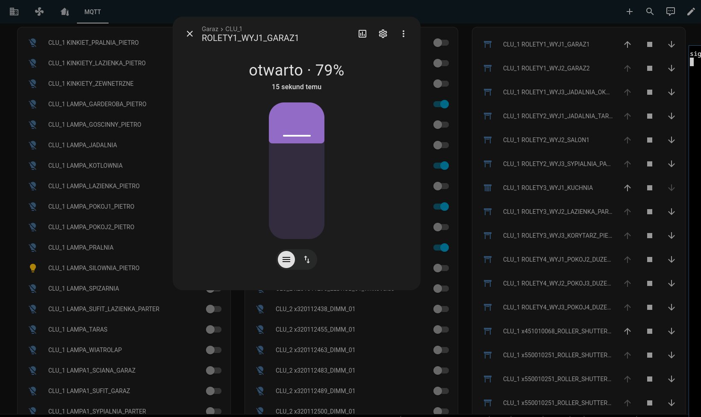
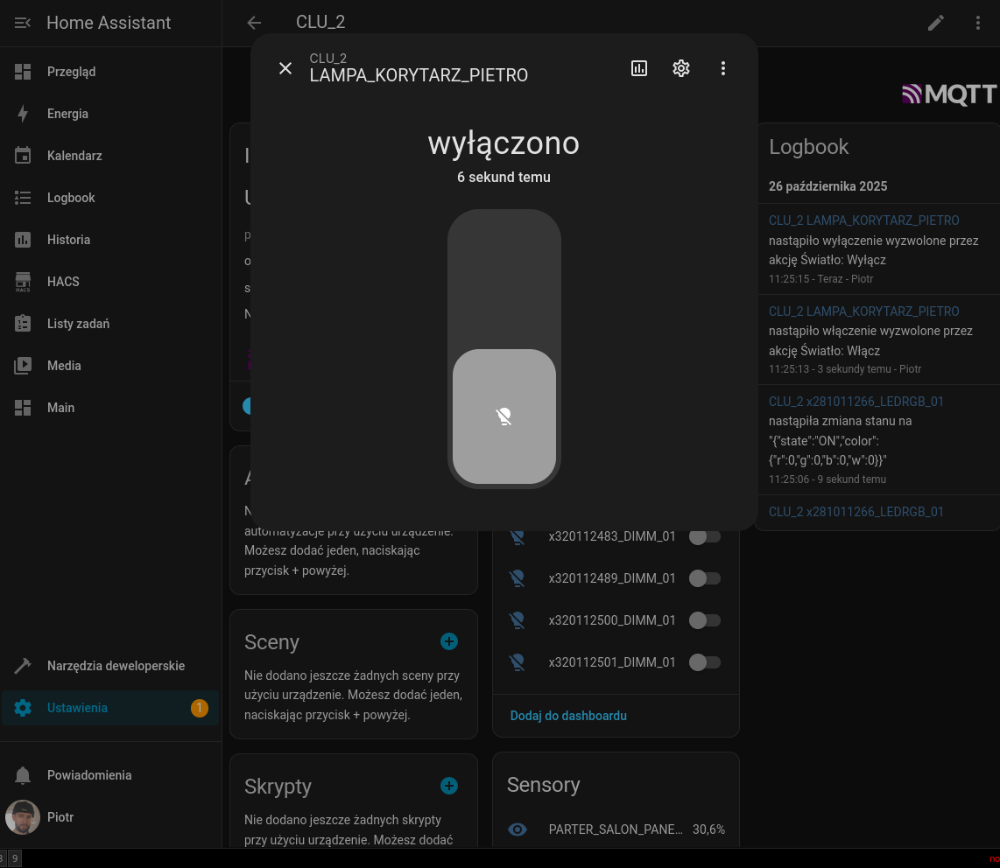
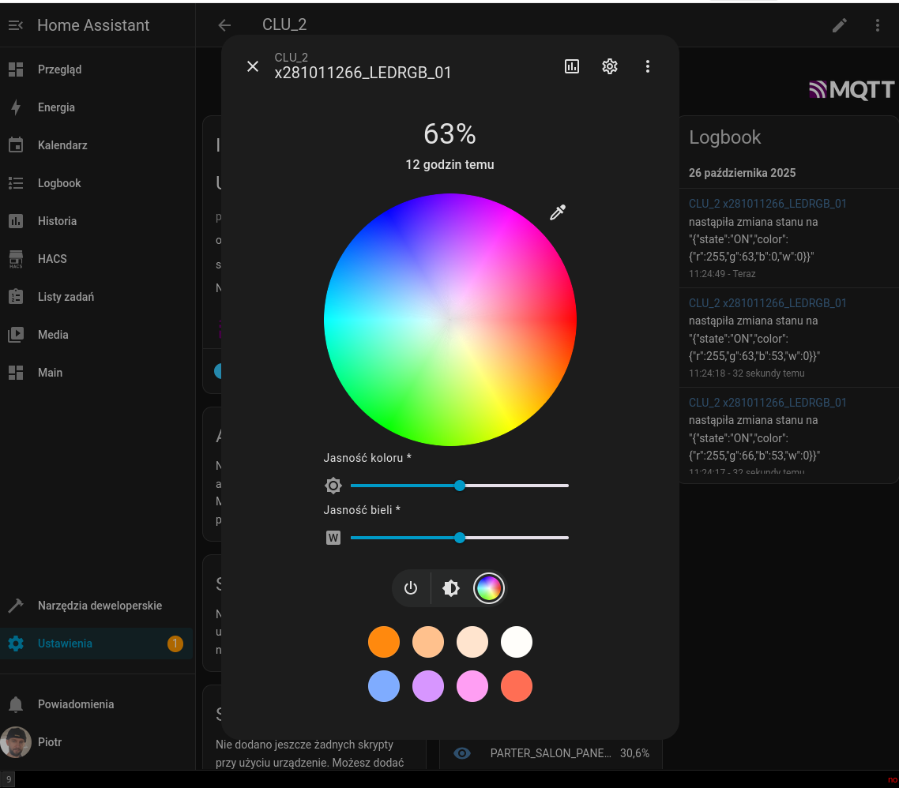
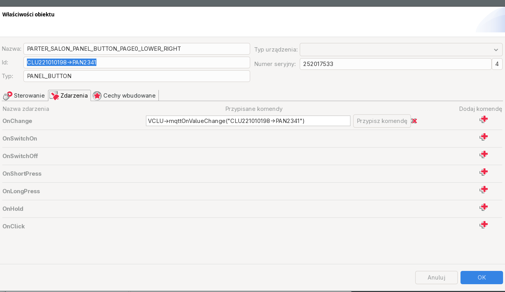
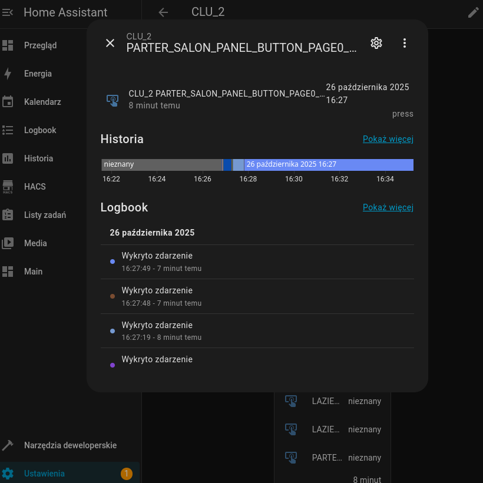
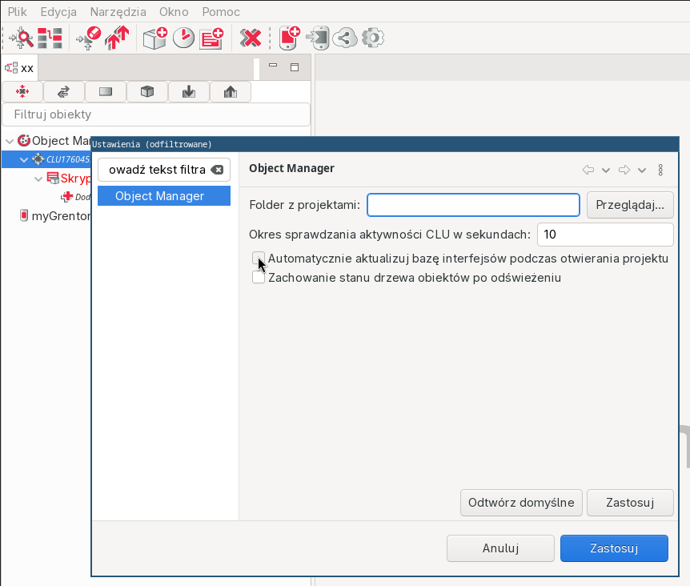
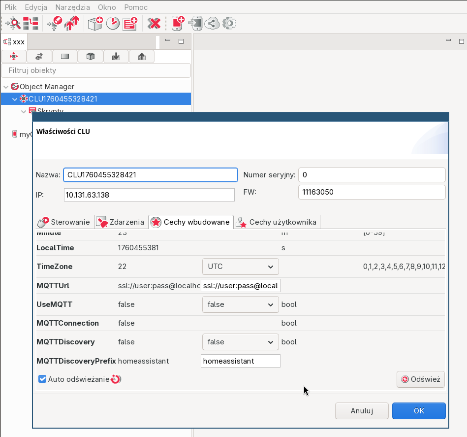
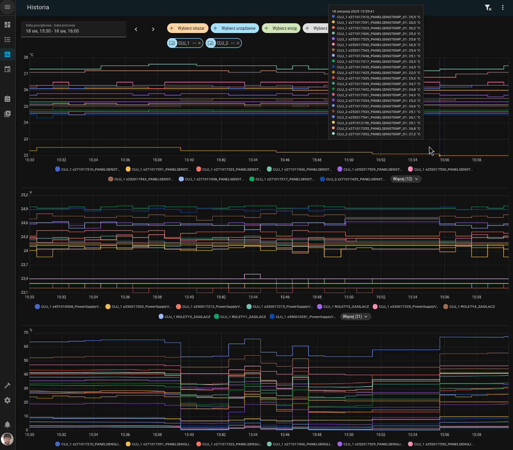

[](https://github.com/psobiech/opengr8on/releases)
[](https://github.com/psobiech/opengr8on/pkgs/container/opengr8on)
[](https://github.com/psobiech/opengr8on/pkgs/container/opengr8on)
[](https://snyk.io/test/github/psobiech/opengr8on/develop)
[](http://www.gnu.org/licenses/agpl-3.0)

**Nowy projekt / New project:** [opengr8on-node](https://github.com/psobiech/opengr8on-node) — przepisanie w Node.js z pełną dokumentacją protokołu UDP i TFBUS, biblioteką kliencką, narzędziami diagnostycznymi magistrali TFBUS oraz wirtualnym CLU / rewrite in Node.js with full UDP and TFBUS protocol documentation, client library, TFBUS diagnostic tools, and virtual CLU

---

Wirtualna implementacja CLU (VCLU) systemu Grenton w Javie — dojrzała, przetestowana implementacja z pełną integracją Home Assistant przez MQTT. Jeśli szukasz stabilnego vCLU do codziennego użycia z HASS, zacznij tutaj.

### O projekcie

[Grenton](https://grenton.com) to system automatyki budynkowej oparty na urządzeniach CLU i GATE komunikujących się przez UDP/IP (protokół UDB, port 1234, szyfrowanie AES-128-CBC). Do fizycznych modułów (przekaźniki, ściemniacze, rolety, panele) CLU podłącza się przez magistralę RS485 (protokół TFBUS).

VCLU jest kompletny do codziennej integracji z Home Assistant — urządzenia z projektu .omp są automatycznie wykrywane i dodawane do HASS przez MQTT. Może też służyć do zapoznania się z systemem Grenton / Object Manager przed zakupem fizycznego urządzenia.

Wystarczy uruchomić obraz docker VCLU (lub wiele obrazów na różnych urządzeniach, zmieniając numery seryjne) w tej samej sieci co komputer z
Grenton Object Manager (https://grentonsmarthome.github.io/release-en/om/).

Co działa:

- Pełna integracja z Home Assistant przez MQTT (auto-discovery z projektu .omp)
- Większość integracji z OM i skryptowanie LUA (Control, Events, Embedded features, User features, LUA Scripting)
- Komunikacja między CLU i CLU (dostęp do zmiennych z innych CLU) — nawet fizycznych
- Przetestowane na linux/amd64 i linux/arm64 (Raspberry PI4), testy jednostkowe działają również na Windows

Nie działa:

- Jeśli OM przypisze inne adres IP urządzeniu, discovery nie zadziała. Obejście: najlepiej zacząć nowy projekt OM.

  Alternatywne obejście: przypisanie urządzeniu adresu IP, który OM próbuje wymusić — przy kolejnym discovery urządzenie powinno zostać zaakceptowane.

Do zrobienia:

- zaimplementowanie brakujących obiektów
- pomiary
- tryb zabezpieczony (CLU nie akceptuje nowych kluczy ani komend przy użyciu domyślnych kluczy)

### Integracja z Home Assistant (MQTT)

Automatycznie odczytane i dodane do HASS (z projektu .omp) są obecnie następujące urządzenia (wszystkie nazwy są identyczne jak w projekcie .omp):
- Rolety (ROLLER_SHUTTER) 
- Dimmery (DIMM)
- Włączniki (DOUT) 
- Sterowniki RGBW (LEDRGB) 
- Czujniki temperatury (PANELSENSTEMP)
- Czujniki jasności (PANELSENSLIGHT)
- Czujniki napięcia (PowerSupplyVoltage)
- Przyciski (BUTTON, PANEL_BUTTON) — na razie jedynie single press; należy jednak przypisać OnChange danego przycisku do metody na VCLU: `VCLU->mqttOnValueChange("CLU221010198->PAN2341")`, gdzie parametr to identyfikator przycisku (skopiowany z OM),
  np.  

W przypadku automatycznego wykrycia, że dodany został odpowiedni handler na On*Change, manualny polling zostaje wyłączony dla danego urządzenia i VCLU przechodzi w tryb pełni asynchroniczny.
PS: Dla czujników temperatury, jasności itp. lepiej pozostawić polling, gdyż potrafią one raportować zmiany niepotrzebnie często.

### Quickstart (docker-compose + HASS)

1. Zainstalowany docker i docker-compose
1. W Grenton Object Manager (OM) w menu `Okno -> Ustawienia` *odznaczamy* opcję
   `Automatycznie aktualizuj bazę interfejsów podczas otwierania projektu`
1. Pobieramy to repozytorium: `git clone git@github.com:psobiech/opengr8on.git --depth=1 ./vclu`
1. Kopiujemy zawartość katalogu interfejsów `./vclu/runtime/`[device-interfaces](runtime/device-interfaces)`/*` do katalogu
   gdzie zainstalowany jest Grenton Object Manager (do podkatalogu
   `./configuration/com.grenton.om/device-interfaces/`).  Tę czynność musimy
   wykonać po każdej aktualizacji interfejsów.
1. Przechodzimy do katalogu `./vclu/`[runtime](runtime) i edytujemy plik `docker-compose.yml`, zmieniając linijkę
   `command: wlan0` na nazwę interfejsu sieciowego lub lokalny adres IP, np. `command: 192.168.0.111`
1. (opcjonalnie) Kopiujemy nasz obecny projekt do lokalizacji `./vclu/`[runtime](runtime)`/project.omp`
1. Uruchamiamy VCLU poleceniem: `docker-compose up`
1. W OM otwieramy projekt i wykonujemy discovery; dla VCLU jako klucz wpisujemy `00000000` i nie zmieniamy adresu IP.
1. Powinniśmy już widzieć VCLU w OM jak inny normalny CLU.
1. Jeżeli dodaliśmy plik projektu .omp, możemy teraz uzupełnić dane do serwera MQTT oraz uruchomić MQTT
   discovery. 
   

### Quickstart (docker run)

* Zakładamy, że OM jest rozpakowany w `$OM_HOME` (https://grentonsmarthome.github.io/release-en/om/).

1. Skopiuj wszystkie interfejsy urządzeń VCLU [device-interfaces](runtime%2Fdevice-interfaces) do
   `$OM_HOME/configuration/com.grenton.om/device-interfaces/`
1. Uruchom ponownie OM lub przeładuj interfejsy urządzeń
1. Sklonuj katalog `./runtime` z tego repozytorium
1. Uruchom Virtual CLU (zamień `eth0` na nazwę interfejsu sieciowego lub podaj lokalny adres IP)
   ```bash
   docker run --net host --mount type=bind,source=./runtime,target=/opt/docker/runtime ghcr.io/psobiech/opengr8on-linux-amd64:latest eth0
   
   # Dla arm64
   docker run --net host --mount type=bind,source=./runtime,target=/opt/docker/runtime ghcr.io/psobiech/opengr8on-linux-arm64:latest eth0
   ``` 
1. Uruchom discovery w OM
1. Gdy zostaniesz poproszony o klucz, wpisz: `00000000`
   
1. Wirtualny CLU powinien być dostępny jak normalny CLU (mogą pojawiać się błędy dotyczące przypisywania adresu IP,
   gdyż nie możemy go zmieniać z poziomu aplikacji — najlepiej zacząć nowy projekt OM):
   
   

### Obiekty wirtualne

Zachowanie obiektów może różnić się od fizycznych — w niektórych przypadkach jest to zamierzone.

#### MqttTopic

Zaimplementowany: Tak

* Automatycznie konwertuje JSON do/z tabel Lua

[MQTT.md](modules/MQTT.md) (+ konfiguracja brokera mosquitto)

#### Timer

Zaimplementowany: Tak

#### HttpRequest

Zaimplementowany: Tak

* Automatycznie konwertuje JSON/XML/FROM_DATA do/z tabel Lua w zależności od nagłówka Content-Type

#### HttpListener

Zaimplementowany: Tak

* Automatycznie konwertuje JSON/XML/FROM_DATA do/z tabel Lua w zależności od nagłówka Content-Type
* Możliwe dodanie obsługi TLS; aktualnie serwer nasłuchuje na porcie 80

#### Calendar

Zaimplementowany: Nie

#### Scheduler

Zaimplementowany: Nie

#### SunriseSunsetCalendar

Zaimplementowany: Nie

#### PresenceSensor

Zaimplementowany: Nie

#### EventScheduler

Zaimplementowany: Nie

### TFTP

[TFTP.md](modules%2FTFTP.md)

### Przykładowy klient

[CLIENT.md](modules%2FCLIENT.md)

### Budowanie

#### Docker

Wymagana jest sieć hosta, gdyż protokół Grenton wymaga pakietów broadcast.

```bash
docker run --net host --mount type=bind,source=./runtime,target=/opt/docker/runtime ghcr.io/psobiech/opengr8on-linux-amd64:latest eth0

# Dla arm64
docker run --net host --mount type=bind,source=./runtime,target=/opt/docker/runtime ghcr.io/psobiech/opengr8on-linux-arm64:latest eth0
```

lub

```bash
docker run --net host --mount type=bind,source=./runtime,target=/opt/docker/runtime ghcr.io/psobiech/opengr8on-linux-amd64:latest 192.168.31.44

# Dla arm64
docker run --net host --mount type=bind,source=./runtime,target=/opt/docker/runtime ghcr.io/psobiech/opengr8on-linux-arm64:latest 192.168.31.44
```

#### Lokalne

> mvn package -Dmaven.test.skip=true

> java -jar vclu/target/vclu.jar eth0

lub

> java -jar vclu/target/vclu.jar 192.168.31.44

#### Problemy z uprawnieniami portów (Linux; nie dotyczy kontenerów)

Aplikacja wymaga nasłuchu na porcie TFTP 69, który na Linuksie jest portem chronionym (<1024).
Aby ominąć to ograniczenie bez uruchamiania aplikacji jako root:

##### Zmiana zakresu chronionych portów (zalecane)

```bash
# Zezwala na nasłuch na dowolnym porcie przez dowolną aplikację — nie przetrwa restartu
echo 0 | sudo tee /proc/sys/net/ipv4/ip_unprivileged_port_start
```

##### Zezwolenie wszystkim aplikacjom Java na nasłuch na chronionych portach

```bash
# Zezwala wszystkim aplikacjom Java na nasłuch na dowolnym porcie — aktualizacje Javy usuną flagę
sudo setcap 'cap_net_bind_service=+ep' "$JAVA_HOME/bin/java"
```

### Wydajność

[PERFORMANCE.md](modules%2FPERFORMANCE.md)

### Projekt siostrzany

[opengr8on-node](https://github.com/psobiech/opengr8on-node) — implementacja protokołu Grenton w Node.js, z biblioteką kliencką UDP, wirtualnym CLU oraz narzędziami diagnostycznymi TFBUS.

### Licencje

Dokumentacja (katalog `docs/`) jest objęta licencją CC BY-SA 4.0.

Noty katalogowe (datasheets) stanowią własność ich odpowiednich właścicieli.

Pozostały kod źródłowy jest objęty licencją AGPLv3.

### Zastrzeżenie prawne

Projekt nie jest popierany przez, bezpośrednio powiązany z, utrzymywany, autoryzowany ani sponsorowany przez Grenton Sp. z o.o.

Użycie jakichkolwiek nazw handlowych lub znaków towarowych służy wyłącznie celom identyfikacyjnym i referencyjnym i nie implikuje żadnego związku z właścicielem znaku towarowego ani jego marką produktową.

Wszelkie nazwy produktów, logotypy, marki i inne znaki towarowe lub obrazy wymienione na tej stronie stanowią własność ich odpowiednich właścicieli.

Korzystanie z tego oprogramowania może naruszać warunki gwarancji urządzeń Grenton. Użytkownik ponosi wyłączną odpowiedzialność za ocenę zgodności z warunkami gwarancji producenta przed użyciem tego oprogramowania z urządzeniami objętymi gwarancją.

Oprogramowanie jest dostarczane w stanie „takim, jaki jest" (as-is), bez jakichkolwiek gwarancji, wyraźnych ani dorozumianych, w tym między innymi bez gwarancji przydatności handlowej, przydatności do określonego celu ani nienaruszania praw osób trzecich. O ile wyraźnie nie zaznaczono inaczej, osoba która powiązała utwór z niniejszą adnotacją nie udziela żadnych gwarancji dotyczących tego utworu i zrzeka się odpowiedzialności za wszelkie sposoby jego użycia, w najszerszym zakresie dopuszczalnym przez obowiązujące prawo.

---

Java implementation of the Grenton CLU server (VCLU) — mature, well-tested implementation with full Home Assistant integration via MQTT. If you need a stable vCLU for daily HASS use, start here.

### About

[Grenton](https://grenton.com) is a building automation system built around CLU and GATE devices communicating over UDP/IP (UDB protocol, port 1234, AES-128-CBC). CLUs connect to physical hardware modules (relays, dimmers, roller shutters, panels) over an RS485 bus using the TFBUS protocol.

VCLU is complete for daily Home Assistant integration — devices from the .omp project are automatically discovered and added to HASS via MQTT. It can also be used to explore the Grenton system / Object Manager before buying physical hardware.

Just run VCLU docker image (or multiple images on different devices, just adjust the serial numbers) in the same network
as computer running Grenton Object Manager (https://grentonsmarthome.github.io/release-en/om/).

What works:

- Full Home Assistant integration via MQTT (auto-discovery from .omp project)
- Most of OM integration and LUA scripting (Control, Events, Embedded features, User features, LUA Scripting)
- Communication between CLU and CLU (accessing variables from other CLUs) - even physical ones
- Tested under linux/amd64 and linux/arm64 (on Raspberry PI4), unit tests now work also on Windows

Does not work:

- If OM decides to assign different IP address for a device, the discovery will not work. As a workaround starting a
  fresh OM project seems to work best.

  Other workaround would be to assign the device the same IP address as OM tries to force on it, then on next discovery
  the device should be accepted.

TODOs:

- implement missing objects
- measurements
- create fortified mode (when CLU does not accept new keys or commands using default keys)

### Home Assistant Integration (MQTT)

The following devices are currently auto-discovered and added to HASS (from the .omp project), all names identical to those in the .omp project:
- Roller shutters (ROLLER_SHUTTER) 
- Dimmers (DIMM)
- Switches (DOUT) 
- RGBW controllers (LEDRGB) 
- Temperature sensors (PANELSENSTEMP)
- Light sensors (PANELSENSLIGHT)
- Voltage sensors (PowerSupplyVoltage)
- Buttons (BUTTON, PANEL_BUTTON) — currently single press only; you need to assign the button's OnChange to a VCLU method: `VCLU->mqttOnValueChange("CLU221010198->PAN2341")`, where the parameter is the button identifier (copied from OM),
  e.g.  

When auto-detection of the appropriate On*Change handler is detected, manual polling is disabled for that device and VCLU switches to fully asynchronous mode.
Note: For temperature, light, and similar sensors it is better to leave polling enabled, as they can report changes unnecessarily often.

### Quickstart (docker-compose + HASS)

1. Docker and docker-compose installed
1. In Grenton Object Manager (OM) menu `Window -> Settings`, *uncheck* the option
   `Automatically update interface database when opening project`
1. Clone this repository: `git clone git@github.com:psobiech/opengr8on.git --depth=1 ./vclu`
1. Copy the contents of `./vclu/runtime/`[device-interfaces](runtime/device-interfaces)`/*` to the directory
   where Grenton Object Manager is installed (to the subdirectory
   `./configuration/com.grenton.om/device-interfaces/`).  This step must be
   repeated after each interface update.
1. Go to the `./vclu/`[runtime](runtime) directory and edit `docker-compose.yml`, changing the line
   `command: wlan0` to your network interface name or local IP address, e.g. `command: 192.168.0.111`
1. (optional) Copy your current project to `./vclu/`[runtime](runtime)`/project.omp`
1. Start VCLU: `docker-compose up`
1. In OM open the project and run discovery; for VCLU enter key `00000000` and do not change the IP address.
1. VCLU should now be visible in OM like any other normal CLU.
1. If you added your .omp project file, you can now fill in MQTT server data and run MQTT
   discovery. 
   

### Quickstart (docker run)

* Assuming OM is extracted in `$OM_HOME` (https://grentonsmarthome.github.io/release-en/om/).

1. Copy all VCLU [device-interfaces](runtime%2Fdevice-interfaces) to
   `$OM_HOME/configuration/com.grenton.om/device-interfaces/`
1. Restart/Launch OM or Reload Device Interfaces
1. Clone `./runtime` directory from this repository
1. Run Virtual CLU (replace `eth0` with your network interface name or specify a local IP address)
   ```bash
   docker run --net host --mount type=bind,source=./runtime,target=/opt/docker/runtime ghcr.io/psobiech/opengr8on-linux-amd64:latest eth0
   
   # For arm64
   docker run --net host --mount type=bind,source=./runtime,target=/opt/docker/runtime ghcr.io/psobiech/opengr8on-linux-arm64:latest eth0
   ``` 
1. Start OM Discovery
1. When prompted for KEY type: `00000000`
   
1. Virtual CLU should be available like normal CLU (you might see errors regarding IP address assignment, since we
   cannot change IP address from an application, currently its best to start a fresh OM project):
   
   

### Virtual Objects

Object behaviour may differ from physical CLU ones, in some cases its intentional.

#### MqttTopic

Implemented: Yes

* Automatically converts JSON from/to Lua Tables

[MQTT.md](modules/MQTT.md) (+ mosquitto broker configuration)

#### Timer

Implemented: Yes

#### HttpRequest

Implemented: Yes

* Automatically converts JSON/XML/FROM_DATA from/to Lua Tables, depending on Content-Type headers

#### HttpListener

Implemented: Yes

* Automatically converts JSON/XML/FROM_DATA from/to Lua Tables, depending on Content-Type headers
* Might add TLS support, currently server binds on port 80

#### Calendar

Implemented: No

#### Scheduler

Implemented: No

#### SunriseSunsetCalendar

Implemented: No

#### PresenceSensor

Implemented: No

#### EventScheduler

Implemented: No

### TFTP

[TFTP.md](modules%2FTFTP.md)

### Example Client

[CLIENT.md](modules%2FCLIENT.md)

### Build

#### Docker

Host networking is required, since Grenton protocol requires broadcast packets.

```bash
docker run --net host --mount type=bind,source=./runtime,target=/opt/docker/runtime ghcr.io/psobiech/opengr8on-linux-amd64:latest eth0

# for arm64
docker run --net host --mount type=bind,source=./runtime,target=/opt/docker/runtime ghcr.io/psobiech/opengr8on-linux-arm64:latest eth0
```

or

```bash
docker run --net host --mount type=bind,source=./runtime,target=/opt/docker/runtime ghcr.io/psobiech/opengr8on-linux-amd64:latest 192.168.31.44

# for arm64
docker run --net host --mount type=bind,source=./runtime,target=/opt/docker/runtime ghcr.io/psobiech/opengr8on-linux-arm64:latest 192.168.31.44
```

#### Local

> mvn package -Dmaven.test.skip=true

> java -jar vclu/target/vclu.jar eth0

or

> java -jar vclu/target/vclu.jar 192.168.31.44

#### Port binding permission issues (Linux, not required for containers)

The application requires to bind to port TFTP 69, which on Linux is a protected port (<1024).
To bypass this limitation and not need to run the application as root, you can:

##### Change protected port range (recommended)

```bash
# Enables binding to any port by any application - does not persist after reboot
echo 0 | sudo tee /proc/sys/net/ipv4/ip_unprivileged_port_start
```

##### Allow all java applications to bind on protected ports

```bash
# Enables binding for all java applications to any port - java updates will clear the flag
sudo setcap 'cap_net_bind_service=+ep' "$JAVA_HOME/bin/java"
```

### Performance

[PERFORMANCE.md](modules%2FPERFORMANCE.md)

### Sister project

[opengr8on-node](https://github.com/psobiech/opengr8on-node) — Node.js implementation of the Grenton protocol, with UDP client library, virtual CLU, and TFBUS diagnostic tools.

### Licenses

Documentation (`docs/` directory) is licensed under CC BY-SA 4.0.

Datasheets are owned by their respective owners.

All other code is licensed under AGPLv3.

### Disclaimer

This project is not endorsed by, directly affiliated with, maintained, authorized, or sponsored by Grenton Sp. z o.o.

The use of any trade name or trademark is for identification and reference purposes only and does not imply any
association with the trademark holder of their product brand.

Any product names, logos, brands, and other trademarks or images featured or referred to within this page are the
property of their respective trademark holders.

Use of this software may void the warranty of your Grenton devices. It is solely your responsibility to evaluate whether using this software with warranted hardware complies with the manufacturer's warranty terms.

This software is provided "as-is", without warranty of any kind, express or implied, including but not limited to the warranties of merchantability, fitness for a particular purpose, and non-infringement. Unless expressly stated otherwise, the person who associated a work with this deed makes no warranties about the work, and disclaims liability for all uses of the work, to the fullest extent permitted by applicable law.
